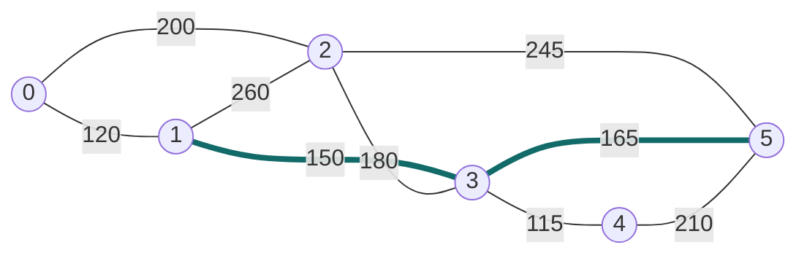

# Urban Garbage Collection Routing

**Graph Theory Assignment**
**Group 18**

| Group member roll numbers |
| --- |
| CSMMA26A037 |
| CSMMA26A038 |
| CSMMA26A048 |

### Project focus

The Chinese Postman method for covering a municipal road network, with depot-based trips for capacity-constrained waste collection.

### Submission contents

Problem statement, data source and graph, algorithm, implementation, results, future work and bibliography.

<!-- page -->

## Abstract

Municipal garbage collection combines two requirements. A vehicle needs to cover the roads in its service area, and the fleet must collect waste without exceeding the capacity of any truck. This project models the road network as a weighted graph and uses the Chinese Postman Problem to compute a minimum-distance closed circuit that traverses every eligible road edge. It then divides the circuit into feasible trips, adding shortest-path connections to the depot wherever a truck must unload or another truck takes over.

The live application models OpenStreetMap roads as a directed multigraph to retain one-way streets and distinct parallel edges. The solver uses minimum-cost flow to balance the directed graph. For the undirected reference graph, it pairs odd-degree vertices using shortest-path distances. In both cases, an Euler circuit on the augmented graph provides the service order. The fleet planner assigns bins along that order and chooses depot breaks with dynamic programming.

The six-node reference graph requires 315 m of repeated road traversal, giving a minimum road-coverage circuit of 1,960 m. The evaluation log also records a Panaji road extract in which the planner covered 58 directed edges and served 12 bins in four trips. Synthetic runs at 10 and 1,000 bins exercised the same planner on a graph with 6,240 directed edges.

| Report question | Evidence |
| --- | --- |
| Does the circuit cover the required roads? | Hand-worked graph, independent small-graph tests and edge counts. |
| Do collection trips respect capacity? | Per-trip loads, explicit depot returns and tests for infeasible bins. |
| Where does the extra distance come from? | Repeated roads in the Postman circuit and depot connectors in the fleet plan. |

**Keywords** — Chinese Postman Problem, Euler circuit, minimum-cost flow, directed multigraph, OpenStreetMap, waste collection.

<!-- page -->

## Contents

| Section | Topic | A4 page |
| --- | --- | ---: |
| 1 | Problem statement | 4 |
| 1.1 | Inputs, constraints and expected outputs | 5 |
| 1.2 | Objectives and acceptance criteria | 6 |
| 2 | Data source and graph | 7 |
| 2.1 | Directed road representation | 8 |
| 2.2 | Six-node reference graph | 9 |
| 2.3 | Evaluation datasets and data quality | 10 |
| 3 | Algorithm | 11 |
| 3.1 | Undirected Postman method | 12 |
| 3.2 | Directed Postman method | 13 |
| 3.3 | Euler circuit and edge coverage | 14 |
| 3.4 | Capacitated trip planning | 15 |
| 3.5 | Correctness, complexity and limitations | 16 |
| 4 | Implementation | 17 |
| 4.1 | Graph loading and placement | 18 |
| 4.2 | Solver, fleet planner and API | 19 |
| 4.3 | Dashboard and route playback | 20 |
| 4.4 | Running and testing the application | 21 |
| 5 | Results | 22 |
| 5.1 | Reference trips and distance accounting | 23 |
| 5.2 | Panaji road extract | 24 |
| 5.3 | Synthetic benchmarks and validation | 25 |
| 6 | Future work | 26 |
| 7 | Bibliography | 27 |

<!-- page -->

## 1. Problem statement

### Municipal collection as a road-coverage problem

A municipal depot dispatches vehicles to collect waste from bins placed throughout a service area. The assignment requires coverage of the eligible road network itself. A route that connects only the bin locations can skip a residential street with no recorded bin. In this project, that street still counts toward the coverage requirement. Each permitted traversal has a distance cost, so repeated driving increases the total.

Represent each junction or endpoint as a vertex and each eligible road traversal as an edge. The depot is a designated vertex. The route must leave that vertex, cover the required edges and return. A circuit can revisit junctions and roads when the graph's structure requires it. Counting these repetitions explicitly makes the routing cost auditable.

Collection adds a second requirement. A bin has a known waste demand, and a truck can carry waste only up to its capacity. Once the truck returns to the depot, the next trip begins with an empty load. A physical visit to a road node can occur several times, while collection of a particular bin is scheduled once.

| Decision | Question answered |
| --- | --- |
| Coverage circuit | Which roads must be repeated to obtain a minimum-distance closed walk? |
| Trip boundaries | Where should collection pause so that each trip fits a truck's capacity? |
| Truck assignment | Which selected truck has enough capacity for each planned trip? |
| Exception reporting | Which roads or bins fall outside the feasible plan, and for what reason? |

The two-stage model first solves the Chinese Postman Problem on the eligible graph and then minimizes extra depot travel for the resulting circuit and bin order. [1]

<!-- page -->

### 1.1 Inputs, constraints and expected outputs

The road graph supplies the permitted movements and their lengths. The user supplies a depot, the collection bins and a set of available trucks. The application associates each bin with a nearby graph node so that geographic locations can be combined with graph routes.

| Symbol | Meaning |
| --- | --- |
| G = (V, E) | Road graph with vertices V and eligible edges E |
| s | Depot vertex |
| w(e) | Length of road edge e in metres |
| q(i) | Waste demand of bin i |
| Q(t) | Carrying capacity of truck t |
| W | Closed road-coverage walk |
| L(W) | Sum of edge lengths for all traversals in W |

Every eligible edge must occur at least once in the combined trip geometry. Each trip must start and end at the same depot. The total demand collected on a trip may equal the assigned truck's capacity. If a bin's demand exceeds the capacity of every selected truck, it is reported as unassigned because the model treats its demand as indivisible.

A truck may carry out several trips. The project models each depot return as an opportunity to unload, which lets the planner treat each trip as a fresh capacity allocation. When two bins share the same snapped road node, they remain separate records with separate demands.

The output includes the road-coverage circuit distance, total fleet distance, per-truck trip lists, scheduled collection stops, trip loads and route geometry. It also reports covered and excluded edges and any unassigned bins. This distinction matters when a road can be reached from the depot in one direction but cannot be followed by a legal return within the loaded graph.

<!-- page -->

### 1.2 Objectives and acceptance criteria

Distance is measured in metres, and coverage is checked on graph edges. Two alternatives can visit the same junctions and cover different roads, especially when parallel links connect the same pair of nodes. An edge-level check is therefore necessary to demonstrate that a result satisfies the assignment.

| Criterion | How it is checked |
| --- | --- |
| Full eligible road coverage | Compare every original eligible edge ID with the traversed edges. |
| Depot closure | Verify that each trip begins and ends at the depot. |
| Directed feasibility | Check that every arc traversal follows an allowed direction. |
| Capacity feasibility | Compare each trip's assigned bin demand with the truck capacity. |
| Unique collection | Verify that each assigned bin occurs in one collection list. |
| Distance reconciliation | Sum the lengths of traversed edges, including every repeated traversal. |
| Explicit exclusions | Show the count of excluded roads and the reason each bin was unassigned. |

The base circuit has a well-defined optimum for the graph used by the solver. Its length is a lower bound on the distance of a feasible fleet plan for the same required edge set. In particular, each trip is closed at the same depot, so the separate trips can be concatenated into a single closed walk that still covers all required edges.

The chosen truck model assumes known demand, repeatable trips and a single depot. The implementation uses road length and mapped travel direction. Its operating model leaves traffic, loading time, vehicle-specific access, turn restrictions and driver shift limits for future work. As a result, distance is the primary evaluation measure. Actual collection time requires additional operational data.

<!-- page -->

## 2. Data source and graph

### OpenStreetMap and operating inputs

The application retrieves drivable road data from OpenStreetMap through the Overpass service using OSMnx. The geographical selection consists of a center and an area half-width. The user can find a place by name with Photon or select a point on the map. The application then requests the road network for that area. The road data and the basemap are credited to OpenStreetMap contributors. [2–4]

The implementation distinguishes the downloaded road graph from the operational records entered for a simulation. OpenStreetMap provides the geometry and network direction. Depot coordinates, bin positions, bin demands and truck capacities are set by the user. This separation allows the same roads to be tested under different demand and fleet assumptions.

| Input | Origin | Role in planning |
| --- | --- | --- |
| Road topology | OpenStreetMap via Overpass and OSMnx | Defines permitted transitions. |
| Edge geometry and length | Road graph returned by OSMnx | Draws the route and contributes to distance. |
| Place-search result | Photon | Helps choose the center of the study area. |
| Depot location | User-selected coordinates | Sets the start and end of each trip. |
| Bin locations and demand | User-entered simulation data | Defines the collection work and required load. |
| Truck capacity | User-entered fleet data | Sets the maximum load per trip. |

A search result identifies a geographic point. The solver needs a road node, so the application snaps the selected position to the graph. A bin outside the requested area is reported as unassigned. This check prevents a distant bin from being treated as though it were on the nearest road at the study boundary.

<!-- page -->

### 2.1 Directed road representation

The live graph is a weighted directed multigraph. A road segment can contribute two arcs if travel is permitted in both directions. A one-way segment contributes the permitted arc only. Parallel edges may share a start and an end, and the graph distinguishes them using edge keys. Their weights and geometries can differ.

For a graph edge identified by <u, v, key>, u is the starting node and v is the ending node. The key prevents a coverage check from counting two parallel links as one. When a shortest-path connector is reconstructed from its sequence of nodes, the planner selects the cheapest usable edge between each successive pair. The Postman circuit itself retains the keys of all required original edges.

| Graph concept | Interpretation in this assignment |
| --- | --- |
| In-degree | Number of arcs entering a road node. |
| Out-degree | Number of arcs leaving a road node. |
| Edge weight | Length of one permitted traversal. |
| Strong connectivity | A directed path exists between every ordered pair of nodes in the component. |
| Walk | Successive edges with valid endpoints, allowing repetitions. |
| Closed walk | A walk that ends at its starting node. |

The depot's strongly connected component consists of the nodes reachable from the depot that can also reach the depot. An arc on a closed depot walk has both endpoints in that component. Conversely, for an arc entirely inside the component, a truck can reach its tail, traverse the arc and return from its head. The planner uses the subgraph induced by these nodes as its coverage area and counts edges outside it separately.

<!-- page -->

### 2.2 Six-node reference graph

The synthetic graph has depot **0** and five collection points at vertices **1–5**. Roads are undirected. Each bin contributes one unit of waste, and the truck can carry three units. The edge list below is sufficient to reproduce the graph without access to a map service.

| Road | Length (m) | Road | Length (m) | Road | Length (m) |
| --- | ---: | --- | ---: | --- | ---: |
| 0–1 | 120 | 0–2 | 200 | 1–2 | 260 |
| 1–3 | 150 | 2–3 | 180 | 2–5 | 245 |
| 3–4 | 115 | 3–5 | 165 | 4–5 | 210 |

| Vertex | Adjacent vertices | Degree | Parity |
| --- | --- | ---: | --- |
| 0 | 1, 2 | 2 | Even |
| 1 | 0, 2, 3 | 3 | Odd |
| 2 | 0, 1, 3, 5 | 4 | Even |
| 3 | 1, 2, 4, 5 | 4 | Even |
| 4 | 3, 5 | 2 | Even |
| 5 | 2, 3, 4 | 3 | Odd |

The degree sum is 18, twice the nine-road count. Vertices 1 and 5 are the only odd-degree vertices, so the example has exactly one possible pairing. Its shortest connecting path determines the repeated roads. This graph is small enough to check by hand while still requiring both edge duplication and a capacity split.

The three-unit truck needs at least two collection trips because total demand is five units. The order of visits affects where the truck can break the circuit cheaply. Two equally short coverage circuits for the same graph can lead to different fleet distances.

<!-- page -->

### 2.3 Evaluation datasets and data quality

The evaluation uses three kinds of data, each chosen for a different check.

| Dataset | Size | What it tests |
| --- | --- | --- |
| Six-node reference | 6 vertices, 9 undirected roads, 5 bins | Hand calculation of odd degrees, repeated distance and feasible trips. |
| Panaji, Goa extract | 29 vertices, 58 directed edges, 12 bins | Road geometry and coverage on a small real street network. |
| Seeded synthetic grid | 1,600 nodes, 6,240 arcs, 10 to 1,000 bins | Planner behaviour at larger bin counts with repeatable inputs. |

The 40 × 40 grid has 40 rows with 39 horizontal links each and 40 columns with 39 vertical links each. This gives 3,120 undirected links. Treating every link as bidirectional gives 6,240 directed arcs. Each arc is 100 m long, and the depot is placed at grid node (20, 20). A seeded random generator selects bin cells, so multiple bins can occupy a single road node while keeping separate demands.

The Panaji case uses mapped roads and simulated bin demand. The road extract was supplied through a test adapter to the production graph loader and optimizer, as recorded in the project test log. The reported distance depends on the particular extract and configured bins. [Project test log](TEST_LOG.md).

The edges at a downloaded region's boundary may connect to roads outside the selected area. A return path in the full city network may therefore be absent from the loaded graph. Parallel segments and mapped direction must be preserved throughout loading and routing. Snapping also approximates waste collection at the nearest road node, so bin data near divided roads should be checked against local conditions before operational use.

<!-- page -->

## 3. Algorithm

### From a road graph to a fleet plan

The Chinese Postman Problem asks for a shortest closed walk that uses every required edge. When the input graph already admits an Euler circuit, a walk that uses each edge exactly once achieves the sum of the original lengths. Otherwise, the solver first duplicates a minimum-cost set of traversals. This creates a graph with the degree conditions required for an Euler circuit. [1]

The planner starts by determining which roads lie in the depot's round-trip network. For the directed graph, it intersects the nodes reachable from the depot with those that can reach it. For the undirected reference, it uses the depot's connected component. The solver handles the two graph types with different augmentation rules.

| Stage | Input | Output |
| --- | --- | --- |
| Load and filter | Road data and depot | Depot's eligible road graph |
| Augment | Original edges and lengths | Balanced or even-degree graph |
| Traverse | Augmented graph and depot | Ordered road-edge circuit |
| Schedule bins | Circuit and snapped bin locations | Ordered collection stops |
| Split and assign | Stop demands and truck capacities | Closed, feasible collection trips |
| Reconcile | Trips, original graph and excluded bins | Coverage, distances, loads and exceptions |

The same original roads remain required after augmentation. Added traversals are copies of roads that already exist. This preserves physical geometry and direction throughout the process. The fleet planner also retains the ordered road-edge circuit so that inserting depot connectors leaves the required road coverage intact.

The route objective accounts for distance throughout. It considers the extra distance needed to make the graph Eulerian first, then the additional distance needed to unload or change trucks along the chosen circuit.

<!-- page -->

### 3.1 Undirected Postman method

An undirected connected graph has an Euler circuit if every vertex has even degree. Each arrival at a vertex can then be paired with a departure. A vertex of odd degree requires an additional incident traversal before the route can be closed. The handshaking lemma guarantees that the number of odd-degree vertices is even. [1]

The solver runs Dijkstra's algorithm from each odd vertex needed for the pairwise calculations. It records the shortest distance to the remaining odd vertices and the road paths that realize those distances. These distances form a complete auxiliary graph on the odd vertices. A minimum-weight perfect matching chooses a set of pairs that covers each odd vertex once, at the lowest combined shortest-path cost. [1, 6]

For each matched pair, the solver adds a copy of every edge on its shortest path. Each endpoint gains one extra incident edge. Each intermediate vertex gains two incident edges per passage along the path. This changes the parity of the matched endpoints and preserves the parity of intermediate vertices.

| Candidate from odd vertex 1 to odd vertex 5 | Length calculation | Cost (m) |
| --- | --- | ---: |
| 1 → 3 → 5 | 150 + 165 | 315 |
| 1 → 2 → 5 | 260 + 245 | 505 |
| 1 → 0 → 2 → 5 | 120 + 200 + 245 | 565 |
| 1 → 3 → 4 → 5 | 150 + 115 + 210 | 475 |

Dijkstra identifies 1 → 3 → 5 as the shortest path. After both edges are duplicated, vertex 1 and vertex 5 each have degree 4. Vertex 3 rises from degree 4 to degree 6. All vertices now have even degree, so an Euler circuit exists.

<!-- page -->

### 3.2 Directed Postman method

In a directed graph, a closed traversal needs equal in-degree and out-degree at every vertex when repeated arcs are included. For a vertex v, define its balance requirement as b(v) = out-degree(v) − in-degree(v). The added traversals have to satisfy the following flow condition. [1, 5]

```text
added incoming flow at v − added outgoing flow at v = b(v)
```

A vertex with excess outgoing original arcs needs more added incoming traversals, so it has positive demand. A vertex with excess incoming original arcs needs more added outgoing traversals, so it supplies flow. Each additional traversal costs the length of the arc it follows. The NetworkX network simplex routine finds a minimum-cost flow satisfying all balances. [5]

For example, suppose a graph has two original arcs from A to B and one original arc from B to A. At A, b(A) = 2 − 1 = 1. At B, b(B) = 1 − 2 = −1. One unit of added flow goes from B to A, which balances both vertices. In a larger network, the least costly correction can follow multiple arcs instead of a single direct return.

| Property | How the solver handles it |
| --- | --- |
| Parallel arcs | Keeps every original arc and uses the cheapest parallel arc when adding a repeat between the same endpoints. |
| Self-loop | Retains the original loop for coverage. It contributes equally to in-degree and out-degree. |
| Nonnegative road length | Rejects invalid or negative edge lengths before optimization. |
| Already balanced graph | Skips the flow calculation and traces the original edges. |

The implementation scales the stored numeric lengths to integer costs for the flow and matching routines, then reports route distances using the original lengths.

<!-- page -->

### 3.3 Euler circuit and edge coverage

After augmentation, the graph satisfies the required degree condition and remains connected in the appropriate sense. The solver uses NetworkX to construct an Euler circuit from the depot with edge keys included. The resulting walk traverses every edge of the augmented graph once. Each original edge appears, and each duplicated edge adds one real traversal. [1, 7]

The diagram shows the original roads with lengths in metres. The two highlighted edges receive an extra traversal in the Postman circuit.



One shortest walk on this reference graph follows the sequence below.

```text
0 → 2 → 5 → 3 → 1 → 3 → 5 → 4 → 3 → 2 → 1 → 0
```

The first and last nodes are both the depot. The walk has 11 traversals, consisting of the nine original roads and two repeated roads. It uses road 1–3 twice and road 3–5 twice. Every other road appears once. The distance of the sequence is the sum of the nine original weights and the lengths of these two repetitions.

The solver represents the result as a sequence of directed endpoint pairs with original edge keys. The fleet planner uses these keys to recover the associated geometry and length. This matters on real streets because two segments can have the same endpoints but different shapes.

A bin is scheduled on the first occurrence of its snapped node in the original circuit. Later traversals through the same node do not add another collection stop. The user interface can display the scheduled stops and the full trip geometry, which may include additional road nodes and depot connectors between scheduled stops.

<!-- page -->

### 3.4 Capacitated trip planning

Given the circuit, the planner lists the bins in the order of their first scheduled collection. It assigns a prefix sum to their demands. The load of any consecutive group of bins can then be calculated by subtracting the prefix sum at the start from the one at the end. A group is feasible if it fits a selected truck.

A trip boundary can occur at any circuit position between two consecutive scheduled stops. The cost of a break at position x is the shortest directed distance from x to the depot plus the shortest directed distance back from the depot to x. These distances may differ on a one-way network. If the circuit already passes through the depot between the two stops, the corresponding break has zero connector cost.

If F(i) is the least additional distance required after scheduling the first i stops, the planner tries endpoints j for the next trip. It adds the best break cost after stop j to the cost F(j). The terminal choice after the last stop has zero added break cost because the circuit already ends at the depot. Equal-distance choices favour fewer trips.

```text
F(i) = min over feasible j > i of [break_cost(j) + F(j)]
F(number of scheduled stops) = 0
```

The planner computes the choices backward, then reconstructs the trips forward from the depot. It uses prefix sums, binary search and a heap to maintain feasible endpoint choices. A candidate trip can be assigned to any selected vehicle that can carry its load. The code tries vehicles in rotating order, skipping any that cannot carry the trip.

The bin order and road order remain fixed during this step. Connector traversals can add road visits, while scheduled waste demand remains attached to its assigned trip.

<!-- page -->

### 3.5 Correctness, complexity and limitations

**Coverage.** The Postman circuit includes all original eligible edges. Turning it into trips divides the original circuit into consecutive pieces and adds depot connectors. The pieces still contain every original traversal, so all eligible edges remain covered in the combined plan.

**Capacity and closure.** The planner creates a group only when its summed bin demand fits at least one selected truck. It assigns that group to a truck whose capacity meets the load. Each group starts with a connector from the depot and ends with a connector back. Either connector can be empty when the circuit is already at the depot.

**Distance.** The directed flow and undirected matching stages minimize augmentation cost for the eligible graph. The trip stage minimizes depot connector cost for the chosen circuit and collection order. Two minimum-cost Euler circuits can induce different bin orders, so their best splits can have different distances.

| Operation | Scaling considerations |
| --- | --- |
| Depot reachability | Forward and reverse graph searches scan nodes and edges. |
| Undirected augmentation | Shortest-path runs and the auxiliary matching graph grow with the number of odd vertices. |
| Directed augmentation | The flow graph grows with the road network. Runtime also depends on the imbalance pattern. |
| Euler tracing | Runtime scales with the number of original and repeated edges to emit. |
| Capacity splitting | The heap and binary search use O(b log b) operations for b ordered bins, in addition to shortest-path and circuit scans. |

For a live region, time spent downloading roads and time spent optimizing are different measurements. The synthetic benchmark measures the planner on an already constructed graph. Large areas can increase both the download effort and the size of the computed circuit.

<!-- page -->

## 4. Implementation

### System architecture

The project has a Python backend and a browser-based dashboard. FastAPI exposes endpoints for road loading, depot placement, bin and truck records, optimization and benchmarking. NetworkX provides graph operations. OSMnx reads and builds the real road graph. Next.js and Leaflet support browser controls, mapping and trip replay.

| Component | Repository location |
| --- | --- |
| Road loading and snapping | [backend/app/services/road_network.py](backend/app/services/road_network.py) |
| Directed and undirected Postman solver | [backend/app/algorithms/chinese_postman.py](backend/app/algorithms/chinese_postman.py) |
| Capacity planning | [backend/app/services/fleet_optimizer.py](backend/app/services/fleet_optimizer.py) |
| API requests and simulation state | [backend/app/api.py](backend/app/api.py) |
| Synthetic benchmarks | [backend/app/benchmarks.py](backend/app/benchmarks.py) |
| Dashboard | [frontend/components/Dashboard.tsx](frontend/components/Dashboard.tsx) |
| Map and playback | [frontend/components/RouteMap.tsx](frontend/components/RouteMap.tsx) |

The browser requests the road graph for a selected area and sends the simulator's operational inputs to the backend. The backend computes the routes and returns road coordinates, stops, distances and loads. The map draws the results using those coordinates. The production browser demo and the development dashboard use the same route API and solver.

The server holds the active simulation in process memory. Edits invalidate earlier results so that a route does not appear to reflect changed inputs before it is recomputed. Loading a new road area retains the bin and truck roster, and the planner reassesses the bins against the new graph. Restarting the server clears the active simulation.

<!-- page -->

### 4.1 Graph loading and placement

The operator begins by entering a place name or selecting a location on the map. Place search returns candidate coordinates through Photon. The operator sets the area half-width, which is the distance from the center to each side of the requested bounding box. The interface supports values from 0.5 to 50 km.

The backend requests drivable OpenStreetMap roads through OSMnx and Overpass. It keeps road components long enough to account for coverage exclusions and removes isolated nodes that have no road edges. The depot is snapped to a road node that participates in a closed driving component. Bins submitted inside the loaded bounds are snapped to nearby road nodes and assessed against the depot's eligible component.

| Placement case | Application behaviour |
| --- | --- |
| Depot position is within the area and near a closed road component | Use a valid snapped depot node and expose its coordinates. |
| Depot move lies outside the loaded area | Reject the move with an input error. |
| Bin is inside the area and its snapped node lies in the eligible component | Consider its demand for collection. |
| Bin lies beyond the area or lacks a depot round trip | Keep the bin record and report it as unassigned. |
| New road download fails | Preserve the previously loaded network and route. |

The route payload stores oriented road coordinates. If an edge carries detailed geometry, the renderer can follow the shape of the road between nodes. The interactive map also displays the coordinates of the snapped depot so the operator can see the graph node used for routing.

The provider settings are configurable through `PHOTON_ENDPOINT` and `OVERPASS_ENDPOINT`. A basemap tile template can be selected via `NEXT_PUBLIC_TILE_URL` before building the frontend.

<!-- page -->

### 4.2 Solver, fleet planner and API

The optimizer uses a directed or undirected graph according to the input. The solver validates road weights, duplicates edges to satisfy the Euler conditions, then returns edge keys in the chosen traversal order. The fleet planner uses that order to assemble trips, reconstruct road geometry and sum distances. Decimal arithmetic is used when comparing bin demands with truck capacities, including inputs such as 0.1 and 0.2 kg.

| API endpoint | Purpose |
| --- | --- |
| `GET /api/locations/search` | Find candidate places. |
| `POST /api/network/load` | Load roads around a geographic selection. |
| `GET /api/network/edges` | Inspect the loaded road edges. |
| `GET /api/bins` and `GET /api/trucks` | Read the active roster. |
| `POST /api/routes/optimize` | Compute coverage and trips for the selected inputs. |
| `POST /api/benchmarks/synthetic` | Run the deterministic grid benchmark. |

The route output distinguishes the Postman distance from the full fleet distance. At truck level it includes trip count, collection load, stop sequence and geometry. Each trip also reports its own load and distance. The API sends the list of unassigned bins with the reason for each exclusion.

The application reports input or provider errors according to the operation that failed. For example, a missing road network prevents optimization, and an overloaded bin remains visible even when the other bins can be assigned. The state management protects record creation from concurrent overwrite and ensures that changed route inputs trigger recalculation.

<!-- page -->

### 4.3 Dashboard and route playback

The browser layout lets the operator define the operating area, position bins and choose the trucks that can run. The road map gives visual context, and the controls allow coordinates to be entered explicitly. Bin and truck records can be edited or removed before requesting a new route.

1. Search for a place or use **Pick area on map**, then load the road graph.
2. Move the depot if required. The map displays the road node selected by snapping.
3. Add bins with demands and trucks with capacities, then select the active fleet.
4. Use **Optimize routes** and review covered roads, excluded roads and unassigned bins.
5. Open a truck's trip list and choose **Replay trip** to follow its geometry.

The map draws the planned route by joining the edge geometry in travel order. A trip can pass the same street more than once, so overlapping lines on the map may represent several traversals. The distance totals and ordered geometry account for those repetitions. Playback follows the selected trip's geometry with a moving marker and supports play, pause and seeking. The animation compresses the trip into a short preview.

The exported demonstration is served by FastAPI at `/demo`, and the root `index.html` links to that interface. During development the Next.js dashboard runs separately, with its API URL configurable through `NEXT_PUBLIC_API_URL`. The project test log records checks of the exported and development browser workflows, including playback and a narrow viewport. [Project test log](TEST_LOG.md).

<!-- page -->

### 4.4 Running and testing the application

From the repository root, build the exported browser application.

```bash
cd frontend
npm ci
npm run build:demo
```

In another terminal, start the Python API from the repository root.

```bash
cd backend
python3 -m venv .venv
source .venv/bin/activate
python -m pip install -r requirements.txt
python -m uvicorn app.main:app --port 8000
```

Open the browser demo at [localhost:8000/demo](http://localhost:8000/demo). For dashboard development, use `npm run dev` in the frontend directory and open [localhost:3000](http://localhost:3000). The API serves an interactive endpoint reference at [localhost:8000/docs](http://localhost:8000/docs).

With the backend environment active, install the test client dependency and run the test suite from the backend directory.

```bash
python -m pip install httpx
python -m unittest discover -s tests -v
```

The benchmark can be reproduced with `POST /api/benchmarks/synthetic` using `bin_count` 10 or 1000, `truck_count` 3, `capacity` 10 and `seed` 42. The frontend supplies independent checks through `npm run lint`, `npm run typecheck` and `npm run build`.

<!-- page -->

## 5. Results

### Hand calculation for the six-node graph

The original graph contains nine roads with a combined length of 1,645 m. A closed route that traverses all nine roads must include at least this distance. Since nodes 1 and 5 have odd degree, a total of exactly 1,645 m would leave their degree imbalance unresolved.

The shortest connection between the odd vertices is 1 → 3 → 5. The two edges have lengths 150 m and 165 m, so augmenting the graph costs 315 m. The resulting Euler circuit length follows directly.

```text
Original network length  = 1,645 m
Required repeated length =   315 m
Shortest Postman circuit = 1,960 m
```

| Measure | Result |
| --- | ---: |
| Original road segments | 9 |
| Original distinct roads covered | 9 |
| Extra traversals | 2 |
| Total traversals in reference circuit | 11 |
| Shortest closed coverage distance | 1,960 m |
| Total demand | 5 units |
| Capacity per trip | 3 units |
| Minimum possible trips by demand | 2 |

The reference route attains the distance bound because the extra traversals resolve both odd degrees using a shortest path, and the augmented connected graph has an Euler circuit. Two trips are needed to collect the five units, because a single trip could carry at most three.

<!-- page -->

### 5.1 Reference trips and distance accounting

The assignment's illustrative 1,960 m circuit follows the order given in Section 3.3. One valid capacity split collects bins 2, 5 and 3 on the first trip, then bins 1 and 4 on the second. In the written road sequence below, a node can appear before its scheduled collection trip.

| Trip | Full road sequence | Load | Distance |
| --- | --- | ---: | ---: |
| 1 | 0 → 2 → 5 → 3 → 1 → 0 | 3 units | 880 m |
| 2 | 0 → 1 → 3 → 5 → 4 → 3 → 2 → 1 → 0 | 2 units | 1,320 m |
| Total | 9 original roads covered | 5 units | 2,200 m |

Breaking at node 1 adds the 120 m trip from node 1 to the depot and the 120 m return from the depot to node 1. The two trips therefore total 1,960 + 240 = 2,200 m. The first trip passes node 1 on the way to unload. Bin 1 is collected on the second trip at the scheduled continuation point.

The current backend's reference run returned a different 1,960 m circuit. Its first trip collected two units over 880 m, and its second collected three units over 1,620 m. This gives 2,500 m for two trips. Both outputs preserve capacity and cover all nine original roads. The difference is 300 m, arising from the connector choices available along each circuit's collection order.

This comparison illustrates the scope of the two optimizations. The exact Postman distance is the same in both cases. The added depot travel varies, even when the underlying road-coverage circuits have identical lengths.

<!-- page -->

### 5.2 Panaji road extract

The project test log records a run with a small OpenStreetMap extract from Panaji, Goa. The loader test adapter passed the extract, filtered for drivable ways, through the production road-loader and optimizer. The 29-node graph had 58 directed edges. The scenario configured 12 bins and exercised trip planning on mapped road geometry. [Project test log](TEST_LOG.md).

| Measure | Recorded result |
| --- | ---: |
| Graph nodes | 29 |
| Directed edges covered | 58 of 58 |
| Bins collected | 12 of 12 |
| Waste collected | 24 kg |
| Completed depot trips | 4 |
| Postman circuit | 8,390.524 m |
| Total fleet distance | 10,755.064 m |
| Added depot travel | 2,364.540 m |

Subtracting the Postman distance from the full fleet distance gives 2,364.540 m of extra travel. In this run the depot connectors added about 28.2% to the base circuit length. The recorded fleet distance and load reflect the specific set of bins and extract used for validation. A larger part of Panaji or a different depot would produce a different planning problem.

The test provides evidence that the planner can return valid route geometry and full coverage on an authentic road extract. The recorded browser checks also verified playback and tile rendering. Live Photon and Overpass access remained unverified end to end in the test environment. The project log records connection timeouts for those providers. [Project test log](TEST_LOG.md).

<!-- page -->

### 5.3 Synthetic benchmarks and validation

Both benchmark runs used the same directed grid, three trucks with 10 kg capacity each, a demand of 1 kg per bin and random seed 42. The graph is balanced because every road has a corresponding reverse arc. Its base Postman distance is therefore 6,240 traversals × 100 m = 624,000 m.

| Measure | 10 bins | 1,000 bins |
| --- | ---: | ---: |
| Directed edges covered | 6,240 | 6,240 |
| Bins collected | 10 | 1,000 |
| Unassigned bins | 0 | 0 |
| Capacity violations reported | 0 | 0 |
| Postman distance | 624,000 m | 624,000 m |
| Total fleet distance | 624,000 m | 907,600 m |
| Extra depot travel | 0 m | 283,600 m |

With ten bins, the total load fits one truck and the selected circuit can be completed without an additional unloading break. With a thousand bins, the fixed graph still requires the same road circuit, but the waste load creates many more depot trips. The distance added by those trips is about 45.4% of the base circuit.

The backend suite includes an independent exhaustive search on small graphs to check the solver's distance. It also checks directed and undirected coverage, parallel edges, a self-loop, invalid weights and infeasible road connections. Fleet tests compare the trip splitter against an exhaustive search of breakpoints and exercise shared bin nodes, decimal loads and unassigned bins. API tests cover input changes and provider failure. The recorded suite passed 11 tests. [Project test log](TEST_LOG.md).

<!-- page -->

## 6. Future work

**Choose circuits with collection in mind.** Evaluate alternate Euler circuits for the same augmentation and score each by its best capacity split. The six-node example provides a small regression case for comparing circuit choices. A longer-term improvement would jointly optimize the required edge coverage and capacity-limited trips.

**Add operating constraints.** Incorporate truck-specific road access, turn restrictions and estimated travel times. Add collection durations at bins and unloading times at the depot so that the planner can assess shift limits. Separate mileage and time metrics would make it possible to compare operational choices using the same graph.

**Support additional depot and disposal locations.** A truck may start at a vehicle yard and unload at a different facility. A future model could choose unloading locations, account for facility operating hours and include the cost of returning vehicles to their assigned yards.

**Strengthen real-world evaluation.** Save a reusable road extract with its source date and bounds, the depot coordinates, and the exact bin and truck inputs. Run the full live place-search and download workflow on a network that can reach both providers. Compare planned routes with anonymized collection logs to measure distance, completion time and missed service.

| Proposed extension | Evaluation measure |
| --- | --- |
| Alternative circuit selection | Added depot distance on the same graph and roster. |
| Turn and access restrictions | Invalid movements found when checked against local road rules. |
| Travel-time and shift model | Difference between planned and observed trip time. |
| Repeatable extract-based tests | Same input graph, coverage and distance on rerun. |
| Multiple depots or disposal facilities | Total fleet distance and unloading detour time. |

<!-- page -->

## 7. Bibliography

1. Edmonds, J., & Johnson, E. L. (1973). *Matching, Euler tours and the Chinese postman*. Mathematical Programming, 5, 88–124. The paper develops the matching formulation and discusses Euler-tour construction. [DOI 10.1007/BF01580113](https://doi.org/10.1007/BF01580113).
2. OpenStreetMap contributors. *Copyright and license*. Source and attribution for the mapped road data used by the application. [OpenStreetMap data attribution](https://www.openstreetmap.org/copyright).
3. Boeing, G. (2017). *OSMnx: New methods for acquiring, constructing, analyzing, and visualizing complex street networks*. Computers, Environment and Urban Systems, 65, 126–139. [DOI 10.1016/j.compenvurbsys.2017.05.004](https://doi.org/10.1016/j.compenvurbsys.2017.05.004).
4. Komoot and Photon contributors. *Photon*. The project documentation describes the geocoder used for place search. [Photon source and documentation](https://github.com/komoot/photon).
5. NetworkX developers. *Network simplex*. The reference defines flow demands and the minimum-cost-flow routine used in the directed augmentation. [NetworkX minimum-cost-flow documentation](https://networkx.org/documentation/stable/reference/algorithms/generated/networkx.algorithms.flow.network_simplex.html).
6. Dijkstra, E. W. (1959). *A note on two problems in connexion with graphs*. Numerische Mathematik, 1, 269–271. [DOI 10.1007/BF01386390](https://doi.org/10.1007/BF01386390).
7. NetworkX developers. *Eulerian circuit*. The reference documents closed edge traversals and keyed output for multigraphs. [NetworkX Euler circuit documentation](https://networkx.org/documentation/stable/reference/algorithms/generated/networkx.algorithms.euler.eulerian_circuit.html).

### Project evidence

- Group 18. *Urban Garbage Collection GT*. Assignment slides and worked reference case. [Presentation](Data/Urban%20Garbage%20Collection%20GT.pptx).
- Group 18. *Test and fix log*. Records the fixture tests, synthetic benchmark results, Panaji extract run and provider reachability checks. [Project test log](TEST_LOG.md).
